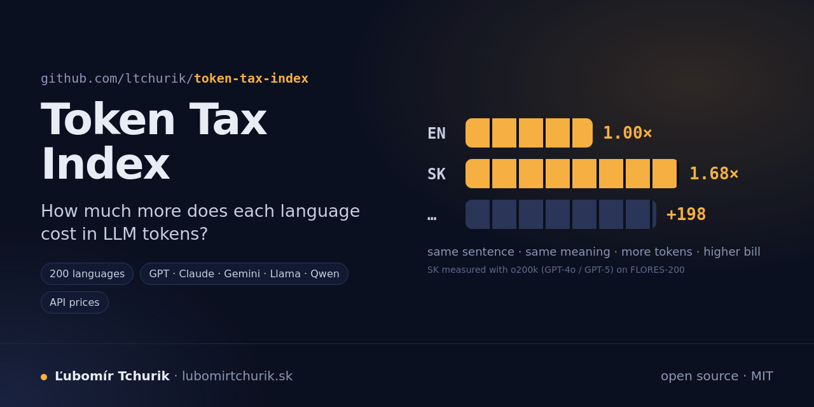

# Token Tax Index

[](https://github.com/ltchurik/token-tax-index)

**How much more does each language cost in LLM tokens?** An open, regularly refreshed index of the "token tax": how many more tokens the same content needs in 200 languages than in English, across the tokenizers of current LLMs, translated into what it means for your API bill and context window.

[](https://github.com/ltchurik/token-tax-index/actions/workflows/ci.yml)
[](LICENSE)
[](pyproject.toml)
[](https://doi.org/10.5281/zenodo.24253588)

**Live leaderboard: [ltchurik.github.io/token-tax-index](https://ltchurik.github.io/token-tax-index/)**, 204 languages × 35 tokenizers, including Claude via Anthropic's token-counting API.

## Key findings (FLORES-200 devtest, November 2026)

- **112 of 203 languages need at least twice as many tokens as English** on the current tokenizers of major vendors (median).
- **Santali is the most expensive language**: the same text costs 12.3× the English price.
- **The fairest major tokenizer is OpenAI's o200k_base** (GPT-4o / 4.1 / 5), with a median language ratio of 1.75×. Claude Sonnet 4.6 is the least fair at 2.17×.
- **Claude 5.5 has a new tokenizer.** Opus, Sonnet and Haiku 5.5 return identical counts, and their median ratio drops to 1.86× from Sonnet 4.6's 2.17×. Part of that gain is a higher baseline, not cheaper languages: Claude 5.5 spends 1.56× as many tokens as o200k_base on the same English text, so lower ratios do not mean lower absolute cost. The site shows both views.
- **Slovak** pays 1.56× (Llama 4) to 2.07× (Qwen 2.5 / 3) on major models; 1.58× on Claude 5.5 and 1.68× on GPT-4o / 5.

Numbers on the site are computed from [`results/`](results/) and are never hand-edited.

## Why it matters

Every LLM API bills per token, and context windows are measured in tokens. Tokenizers are trained mostly on English, so the same sentence in Slovak, Amharic, Burmese or Tamil is split into more pieces. Speakers of those languages pay more for the same answer, get less text into the same context window and wait longer for the same output.

This is well known from research snapshots, but the numbers go stale every time a vendor ships a new tokenizer. The goal of this project is a **living** index: re-measured when models change, with prices attached, so developers, product teams and researchers can look up the current cost of their language instead of citing a 2023 table.

## Method

- **Corpus:** [FLORES-200](https://github.com/facebookresearch/flores) `devtest`, 1012 professionally translated sentences, aligned across 204 language variants. The same meaning in every language makes token counts directly comparable. The corpus is downloaded by `tti fetch-corpus` and not redistributed here (CC BY-SA 4.0).
- **Tokenizers:** 37 open and closed tokenizers registered (35 measured; Gemini pending) (OpenAI tiktoken, Llama, Mistral, Gemma, Qwen, DeepSeek, GLM, Kimi, Phi, EuroLLM and more), plus Claude and Gemini via the vendors' token-counting APIs. The registry is a plain JSON file: [`tokenizers.json`](src/token_tax_index/data/tokenizers.json).
- **Metric:** `ratio_vs_en` = total tokens in language L ÷ total tokens in English on the same sentences, with a 95 % bootstrap confidence interval (resampling sentences). Also reported: characters per token.
- **Counting rules:** no special tokens (BOS/EOS), no chat template. API tokenizers subtract the fixed per-request overhead, measured once per model and checked with a doubling test (count(s + s) − count(s)).
- **Claude:** counted with `messages.count_tokens` on `claude-sonnet-5-5` and `claude-sonnet-4-6`. Opus, Sonnet and Haiku 5.5 returned identical counts on a 6,120-text sample (30 sentences × 204 languages), so they share one row. The open Claude 2 vocabulary is kept as a legacy reference.
- **Headline median:** only current tokenizers of major vendors; tokenizers with identical counts are counted once, regional and reference tokenizers are shown but excluded.
- **Cost:** with list input prices from [`prices.json`](src/token_tax_index/data/prices.json): the cost of the same content in L = English price × ratio, and USD per 1M characters.
- **Reference row:** UTF-8 bytes, to separate "the tokenizer is bad at this language" from "this script simply needs more bytes".

## Quickstart

```bash
pip install "token-tax-index[local] @ git+https://github.com/ltchurik/token-tax-index"

tti fetch-corpus --langs slk_Latn,deu_Latn,amh_Ethi   # or --langs all (eng_Latn is always added)
tti list                                              # registered tokenizers
tti run --tokenizers o200k,gemma,qwen --no-api        # writes results/*.json
tti site                                              # renders site/index.html from results/
```

Claude and Gemini rows need `pip install "token-tax-index[api]"` and `ANTHROPIC_API_KEY` / `GEMINI_API_KEY`. API counts are cached in [`cache/api_counts.json`](cache/api_counts.json) (keyed by a hash of each sentence), and the cache is committed, so `tti run` reproduces the Claude rows without a key.

## Prior art

This project builds on, and tries to complement, earlier work:

- **Petrov et al., 2023**, *Language Model Tokenizers Introduce Unfairness Between Languages* (NeurIPS), with an [interactive page](https://aleksandarpetrov.github.io/tokenization-fairness/). The foundational study on FLORES-200, a snapshot of 2023 tokenizers without prices.
- **[tokentax](https://pypi.org/project/tokentax/)**, a Python package measuring 8 tokenizers on FLORES languages. No site or cost figures, and inactive since its first release.
- **[Arabic Token-Tax Index](https://github.com/Bayanat-Labs/arabic-token-tax-index)** by Bayanat Labs. A careful single-language index (Arabic vs English, 12 tokenizers, with prices).
- **[sk-tokenizer-bench](https://github.com/ltchurik/sk-tokenizer-bench)**, the same author's Slovak benchmark (30+ tokenizers, Slovak vs English, Czech, Polish, Hungarian, German). This project generalizes its code and method to all languages.

What's new here: all FLORES-200 languages × current tokenizers × prices in one place, kept up to date.

## Roadmap

- [x] Measurement pipeline: FLORES-200 download, tokenizer registry, bootstrap CIs, cost table
- [x] Static leaderboard generator (`tti site`) and GitHub Pages deployment
- [x] First full run: 204 languages × all open tokenizers, results committed to `results/`
- [x] Claude rows via the token-count API (cached)
- [ ] Gemini rows via the token-count API
- [ ] Per-language pages: "what does my language cost on each model?"
- [ ] Scheduled refresh when new tokenizers or prices appear
- [x] Language names for all 204 FLORES codes
- [ ] Output-side cost (generation), not only input
- [ ] Embeddable badge: "My language pays 1.6× on model X"

Contributions are welcome, especially new tokenizers in `tokenizers.json`, price updates with a source link, and language names.

## Citing

See [CITATION.cff](CITATION.cff) (GitHub's "Cite this repository" button renders it). Every release is archived on Zenodo; the DOI [10.5281/zenodo.24253588](https://doi.org/10.5281/zenodo.24253588) covers all versions. If you use the numbers, please also cite NLLB Team, *No Language Left Behind: Scaling Human-Centered Machine Translation* (2022).

## Author

Created and maintained by **[Ľubomír Tchurik](https://lubomirtchurik.sk)**, a Linux and PostgreSQL infrastructure specialist from Bratislava, Slovakia, working on LLM evaluation and AI-agent security.

[Website](https://lubomirtchurik.sk) · [GitHub](https://github.com/ltchurik) · [LinkedIn](https://www.linkedin.com/in/lubomir-tchurik/) · [ORCID](https://orcid.org/0009-0005-8053-9405)

If this project is useful to you, a ⭐ on GitHub helps others find it.

### More open-source projects by the author

- [sk-llm-eval](https://github.com/ltchurik/sk-llm-eval): Does your LLM write correct Slovak? 207-task language quality benchmark
- [sk-tokenizer-bench](https://github.com/ltchurik/sk-tokenizer-bench): the Slovak token tax across 30+ LLM tokenizers
- [llm-locale-lint](https://github.com/ltchurik/llm-locale-lint): CLDR-based checker of numbers, dates, money and quotes in LLM output
- [localebench](https://github.com/ltchurik/localebench): do LLMs write like a native? Locale conventions benchmark
- [sk-asr-bench](https://github.com/ltchurik/sk-asr-bench): how well AI understands spoken Slovak
- [pgupcheck](https://github.com/ltchurik/pgupcheck): will your PostgreSQL major upgrade break anything?
- [mcp-jail](https://github.com/ltchurik/mcp-jail): sandbox for MCP servers: egress allowlist, fs scope, audit log

## License

Code: MIT. FLORES-200 is © Meta Platforms, Inc., CC BY-SA 4.0. It is downloaded at run time and not included in this repository.
